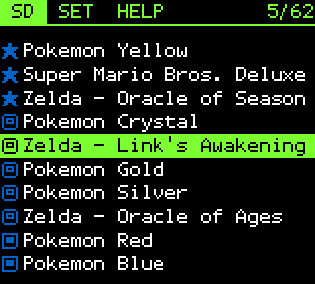
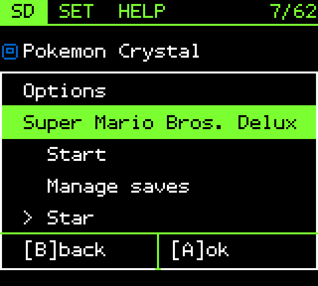
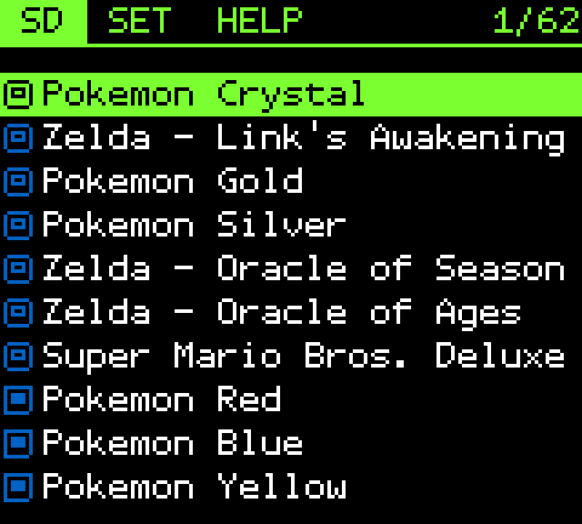

# ezgb-dv

My version of the menu for the EZ Flash Jr, a Game Boy cartridge that plays
games from an SD card. It's based on [lukesau's ezgb](https://github.com/lukesau/ezgb)
(mod 6.9).

| Starred games stay at the top | Hold A on a game to star it | Games sorted by my ranking and play count |
|:---:|:---:|:---:|
|  |  |  |

<sub>Screenshots from the SameBoy emulator, in the colors a Game Boy Color shows.</sub>

## What I changed

- **Console detection:** the menu detects whether it's running on a real Game
  Boy Color or a ModRetro Chromatic, and turns on the firmware's fast-load
  mode only on the Chromatic (on a real Game Boy Color, fast load broke game
  loading). Other FPGA consoles like the Analogue Pocket may be detected the
  same way, but that's untested.
- **Look:** a dark theme with green and blue accents, the Tamzen font, and
  file extensions hidden.
- **Sorting:** games start in the order of my ranking
  ([`dv/ranking.txt`](dv/ranking.txt)) and move up each time they're played.
  Play counts are saved on the cartridge. A setting switches to A–Z.
- **Stars:** hold A on a game and pick Star to keep it at the top.
- **Navigation:** the list wraps around at both ends, with a position counter
  (5/62). Moving the cursor within the page recolors the two rows instead of
  drawing their names again, so it takes about half as long; so does wrapping
  around on a list that fits one page. Scrolling past the top or bottom row
  slides the list and draws only the rows it uncovers, instead of redrawing
  all ten; a wrap on a longer list draws the cursor's row first. Holding UP
  or DOWN repeats after a short pause and speeds up the longer it's held,
  from 10 to 20 moves a second; once the list scrolls it keeps that pace by
  moving up to 4 rows at a time.
- **Daily save backup:** the first time the console starts each day after a
  game was played, the menu copies that game's save to a backup before
  writing the new one over it, with a box that says which game and about how
  long it takes. If a save goes bad (low batteries, for example), Manage
  saves can put back the copy from before that day. Each game keeps one, and
  it can be turned off on the SET tab.
- **Settings:** the SET tab lists the clock first, then the save options,
  sorting and fast launch, with a small left margin. The 8px/12px switch is
  gone, since the menu is always 12px.

## How it's built

The EZ Flash Jr's menu is a program that the Game Boy itself runs. It's a file
on the SD card (`ezgb.dat`) that the cartridge loads every time the console
turns on. EZ Flash only published the finished program, not its source code.

lukesau reverse-engineered that program: they translated it back into
readable Game Boy code, worked out what each part does, and added their own
features (mod 6.9). ezgb-dv builds on that version:

- **New code in two languages.** Game Boy assembly (the processor's own
  instructions) for small low-level parts like console detection, and C for
  bigger ones like the star menu. Free tools (RGBDS for assembly, SDCC for C)
  turn both into code the Game Boy runs.
- **A script puts it in.** [`dv/build.py`](dv/build.py) rebuilds lukesau's
  menu, places the new code in unused space inside it, and changes a few
  existing instructions so the menu calls the new code. Before each change it checks that
  the original bytes are exactly what it expects, because a mistake there
  shows no error: the Game Boy just crashes.
- **Console detection.** The menu writes a number to an unused memory
  address (`$FEA0`) and reads it back. A real Game Boy Color returns the
  number; the Chromatic, an FPGA re-creation of the console, returns 0. An
  original Game Boy also returns 0, so the menu first checks for a register
  that only exists on Game Boy Color hardware.
- **Testing.** 85 automated tests run each new piece of code in the PyBoy
  emulator. 9 more boot the whole menu in the SameBoy emulator with a test SD
  card and check what the save backup leaves on it. The screenshots come from
  a script that runs the menu in SameBoy and presses the buttons.

## Install

The release is a patch file: it holds only my changes, which you apply to
your own copy of EZ Flash's menu file. You need an EZ Flash Jr on firmware
FW5 and EZ Flash's `ezgb.dat` 1.05e-0918 (md5 `5238ac5987d23b68a19d40e43af8c786`).

1. Download `ezgb-dv-1.05e-0918.ips` from the [latest release](../../releases/latest).
2. Apply it to `ezgb.dat` with an IPS patcher such as
   [Rom Patcher JS](https://www.marcrobledo.com/RomPatcher.js/).
3. Copy the result to the SD card as `ezgb.dat` (md5 `fc4f8176fd16d7c1d03f7e39a33b20e8`).

## Build

```sh
brew install rgbds sdcc mtools
python3 dv/build.py --stock ezgb.dat     # dv/build/ezgb-dv.dat and the IPS patch
pip install pyboy pillow
python3 dv/tests/run.py
scripts/setup-sameboy.sh && make -C tools/SameBoy CONF=debug sdl
python3 dv/tests/backup.py               # save backup, on a test SD card
python3 dv/showcase/make_screens.py      # screenshots
```

## Credits

- [lukesau](https://github.com/lukesau/ezgb) for ezgb: the reverse-engineered
  menu, mod 6.9, and its tools. Their README is in [README.upstream.md](README.upstream.md).
- Tamzen font by Suraj N. Kurapati, based on Tamsyn by Scott Fial
  ([license](dv/fonts/LICENSE-Tamzen)).

## License

AGPL-3.0, same as ezgb ([LICENSE](LICENSE)).
